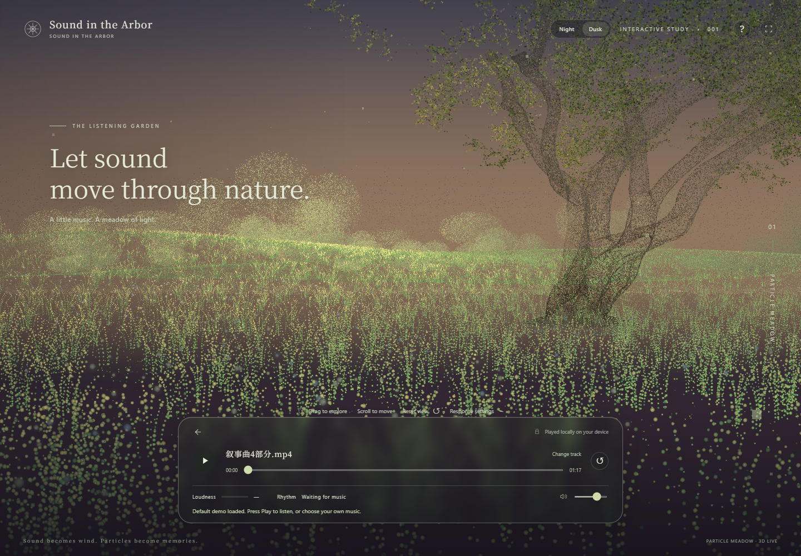

# Sound in the Arbor

An interactive, audio-reactive 3D particle landscape for people who want to explore a visual environment while listening to their own music. Upload a local recording, start playback, explore the meadow, and switch between Night and Dusk.

## Second upload — visual development

This revision focuses on three connected problems: grass density and volume, continuous slopes and depth, and the choice of lighting style. It keeps the landscape entirely particle-based.

- **Grass density:** the dense foreground patch previously ended abruptly. Its distribution now fades continuously into the distance. Some existing ground points form curved, upward-growing grass chains with varied heights and lean; other points remain as ground cover. The desktop landscape contains **891,746 points** after the accepted woodland reinforcement; the music-interaction upgrade adds no particles.
- **Terrain and slopes:** one smooth height field creates broad rolling slopes and low hills. Grass roots, flowers, and trees use the same terrain height. Distant ground samples extend smoothly so a fixed boundary is less visible. Existing grass-cluster thickness is preserved; the camera and controls are retained.
- **Lighting choice:** Night retains the dark purple background and luminous point-cloud style. Dusk uses a low-angle warm directional light, environment fill, approximate particle normals, and a muted warm sky. After visual review, a stronger yellow-green treatment was rejected in favor of softer gray-gold transitions. Tree and grass shadows use a static point-cloud depth map.
- **Player surface:** frosted glass softly reveals a little of the particle background while keeping labels and controls readable.



[Night mode](docs/night.png) · [Terrain before](docs/terrain-before.png) · [Terrain after, same camera](docs/terrain-after.png)

## Run in VS Code

Requires Node.js 22 or newer and a current WebGL-capable browser. No package installation or API key is required.

Open the folder containing `package.json`, then run in its terminal:

```sh
npm start
```

Open **http://127.0.0.1:4173**. Do not open the HTML directly; the application uses ES modules and locally served assets. If the port is occupied, PowerShell users can run `$env:PORT = "4175"` before `npm start`.

## Controls

- **Night / Dusk:** change lighting without rebuilding the scene or interrupting playback. Dusk is the initial mode; the choice is not saved across reloads.
- Drag, scroll, or use arrow keys to explore. Press **R** or **Reset view** to return.
- Drop an MP4 or audio file, or click **Bring your own music**. Press Play or Space to start/pause; use the timeline to seek.
- **Try the demo** loads the creator-selected 77.72-second recording (`叙事曲4部分.mp4`); press Play after loading.
- **Response settings** controls sensitivity and movement; zero movement disables swaying.
- Volume changes playback output without changing the analysis input.

Selected files remain local in the browser and are not uploaded or retained after reloading.

## Audio response

The latest revision improves particle movement speed and its response to music. Quiet passages retain gentle movement, while sustained fast rhythms increase oscillation speed and structural release. Trunk and woody-branch movement is more visible. Grass, tree crowns, branches, trunks and distant trees move along independent fixed axes in the XY plane, with different phases, frequencies, base amplitudes and sensitivities.

Each participating landscape particle follows the same core rule:

> P_i(t) = P0_i + A_i(t) × sin(ω_i × t + φ_i) × D_i

- **P0_i:** the original position of particle i.
- **A_i(t):** its back-and-forth amplitude, which changes with the music.
- **ω_i:** its independent oscillation frequency.
- **φ_i:** its independent initial phase.
- **D_i:** its fixed movement direction vector.

The shared rule gives each particle an independent back-and-forth path. Every frame calculates position from its rest position, so movement does not accumulate into drift. Music changes amplitude smoothly; sustained energetic passages can release the landscape into wider oscillations, and quieter passages allow it to reconstruct. The implementation uses a continuously integrated rhythm-dependent clock in the frequency term, so changing speed does not reset the phase or cause position jumps. The horizon veil and decorative airborne motes retain their existing behavior.

Motion amplitude and structural release are separate controls within the response mechanism. A short loud beat can increase movement without immediately dissolving the whole scene; sustained high energy or continuous fast rhythmic activity progressively releases its structure. AudioWorklet tracks rhythm independently of rendering frame rate, with a spectral fallback. Night/Dusk switching retains these mappings.


## Project files

| File | Purpose |
| --- | --- |
| `dist/particle-meadow.js` | Continuous terrain, grass distribution and chains, sampled tree geometry |
| `dist/scene.js` | Particle rendering, lighting, sky, static shadows, camera and mode selection |
| `dist/app.js` | Local playback, audio connections, UI and lighting-button events |
| `dist/index.html`, `dist/style.css` | English interface, responsive layout and frosted player |
| `dist/audio-features.js`, `dist/rhythm-*.js` | Audio analysis and audio-clock timing |
| `dist/assets/` | Bundled Three.js runtime, licensed tree assets and demo recordings |
| `server.mjs` | Local server with media byte-range support |
| `tests/` | Audio behavior tests |

## Validation and limits

Run `npm run check` for syntax and **13 audio/motion tests**. Historical browser reports in `docs/` describe earlier saved revisions. The current motion revision uses fixed XY-axis oscillation, stronger trunk motion, and sustained fast-rhythm release and acceleration. Normal UI hides all diagnostic overlays. The default demo is now the creator-selected MP4 recording; earlier 48-second demo validation records do not describe this new asset.

The result is stylized point-cloud art, not a photograph or trained Gaussian-splat reconstruction. Tree lighting normals are approximate. The shadow map uses the vegetation's rest pose and does not follow every music-driven movement. Particle shadow softness and detail are limited by a 2048-pixel depth map. First-load asset size and GPU performance vary by device; smaller displays reduce samples and sustained low frame rates reduce pixel ratio. No universal frame-rate claim is made.

Rhythm estimation can struggle with polyphony, legato and noise. MP4 needs a supported codec and an audio track. User feedback and planned improvements are summarized below; the available trial record and design response are documented in PROCESS.md.

## User Feedback and Future Improvements

Earlier feedback praised the visual aesthetics and immersive atmosphere, but described particle movement as intermittent and found the contrast between calmer and more energetic music insufficiently clear. This led to independent oscillation, more visible displacement, and faster movement and structural release during sustained fast rhythms.

**Feedback after the latest revision**

After trying the updated experience, users reported a clear improvement in the particle effects compared with the previous version. Two areas still need attention:

- **Clearer visual contrast between musical examples:** the differences between examples could be more visually pronounced, making changes in musical pace and intensity easier to see.
- **Returning from the demo to personal music:** users reported that after choosing the demo, they could not return to playing their own preferred songs. Although changing the track is part of the intended workflow, this transition needs investigation and improvement. This remains an unresolved usability issue, rather than a completed fix.

This feedback reflects the creator's summary of user trials, rather than validation of every musical style or playback path.

**Previously requested controls**

Earlier users also requested separate settings for particle size, movement speed and movement distance. These remain future improvements; the current interface retains its sensitivity and movement controls.

## Credits

The main tree is sampled from a CC0 model; the solid model is not rendered. See [CREDITS.md](CREDITS.md), [THIRD_PARTY_NOTICES.md](THIRD_PARTY_NOTICES.md), and [PROCESS.md](PROCESS.md) for sources, decisions and AI assistance. No hosting credentials, personal recordings or browser profiles belong in this repository.
