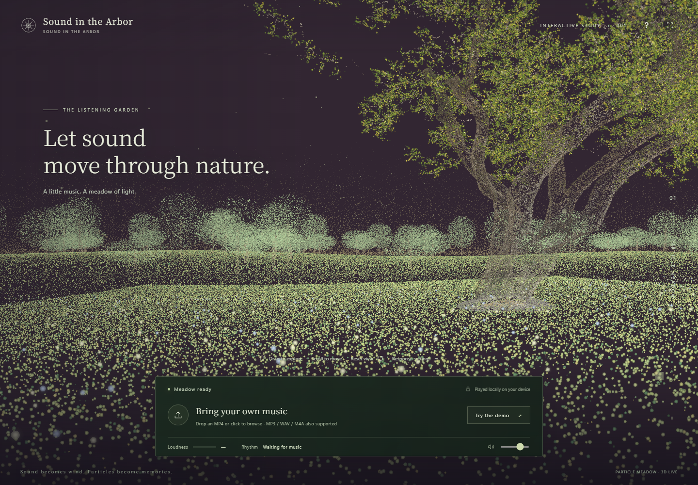

# Sound in the Arbor

An interactive, audio-reactive 3D particle meadow. A mature tree frames the right side of the scene, small points form rolling grass, distant trees establish depth, and a pale-gold particle veil fades into the dark background.

This is the second code delivery. The interface, accessibility labels, application messages, documentation, and source comments are in English.



## Audience and interaction

The provisional audience is listeners who want to explore a visual landscape while listening to their own music. Users choose or drop a local media file, start playback, move the viewpoint, and observe the response. This version explores listening and visual feedback; it does not yet establish whether viewers want to express their personal interpretation of a piece.

## Run locally

Install Node.js 22 or newer. No package installation, API key, or paid service is required.

Open a terminal in the folder containing `package.json`:

```sh
npm start
```

Open **http://127.0.0.1:4173**. Use a current browser with WebGL and hardware acceleration. Do not open `index.html` directly: browser restrictions can prevent ES modules and assets from loading.

If another local server occupies that port, PowerShell users can choose a different one:

```powershell
$env:PORT = "4175"
npm start
```

## Controls

- Drag the scene or use the arrow keys to explore.
- Scroll to move closer; press **R** or **Reset view** to return.
- Drop an MP4 or audio file, or click **Bring your own music** to choose one.
- Press **Play** or **Space** to start or pause.
- Use the timeline to seek, restart the track, or select a different file.
- **Try the demo** loads a 48-second original synthesized study. Press Play after it loads.
- **Response settings** adjusts audio sensitivity and movement. Set movement to zero to disable swaying.
- Volume changes the playback output without changing the analysis input.

Files stay in the browser: the application does not upload or persist the selected recording. Reloading clears the selection.

## Visual and audio design

- Real 3D point coordinates establish depth, occlusion, and parallax. The scene is not a photograph with an overlaid particle effect.
- The main tree samples positions and colors from a CC0 tree model; the solid model is never rendered.
- Smaller, flat ground points mix green, yellow, and dark-green samples. Additional points strengthen the trunk base and roots.
- Distant trees include denser crowns and trunk samples. The far clipping plane is extended to keep them visible.
- Low frequencies influence ground movement; mid frequencies influence vegetation movement; high frequencies influence a small set of luminous points. Background haze is kept still.
- RMS energy controls point size. Rhythmic activity, estimated from note onsets, controls movement speed. The estimate is not an exact score BPM or an emotion classifier.
- AudioWorklet handles rhythmic timing independently of graphics frame rate, with a spectral-analysis fallback.
- Reduced-motion preferences lower motion; smaller displays receive fewer initial samples, and sustained low frame rates reduce pixel ratio.

## Files

| Path | Purpose |
| --- | --- |
| `dist/index.html`, `dist/style.css` | Interface and responsive layout |
| `dist/app.js` | File handling, playback, analysis connections, and UI states |
| `dist/scene.js` | Point shaders, camera controls, and subtle bloom |
| `dist/particle-meadow.js` | Meadow generation, model sampling, roots, and distant layers |
| `dist/audio-features.js` | Energy and fallback spectral analysis |
| `dist/rhythm-core.js`, `dist/rhythm-worklet.js` | Audio-clock onset tracking |
| `dist/assets/` | Locally bundled runtime, model, and original audio |
| `server.mjs` | Local static server with byte-range media support |
| `tests/audio-features.test.mjs` | Audio behavior checks |
| `tools/create-demo.mjs` | Reproducible original demo generation |

## Check

```sh
npm run check
```

These checks cover JavaScript syntax, faster versus slower onsets, loudness without false rhythm, pause/reset behavior, and audio-clock rhythm tracking. Actual browser checks and visual review are recorded in `PROCESS.md`.

## Limitations

- The tree model and its textures add tens of megabytes to the first load; a slow connection can take time. Later loads may use browser caching.
- Rendering performance depends on the device and browser. This is a particle artwork, not a photorealistic environment or a trained Gaussian-splat reconstruction.
- Complex polyphony, legato passages, noise, and abrupt changes can delay or confuse the rhythm estimate.
- MP4 playback depends on its codec and audio track. AAC audio in MP4, MP3, and WAV are practical choices. A silent video cannot drive the visual response.
- A real participant test is still required for the assignment. Automated browser checks do not replace it.
- The previously hosted Chinese-language prototype is separate from this English code delivery and is not evidence that this English revision has been deployed.

## Credits and process

See `CREDITS.md`, `THIRD_PARTY_NOTICES.md`, and `PROCESS.md` for asset sources, licenses, development decisions, and AI use. The export excludes hosting credentials, deployment configuration, browser profiles, personal recordings, and abandoned rendering experiments.
