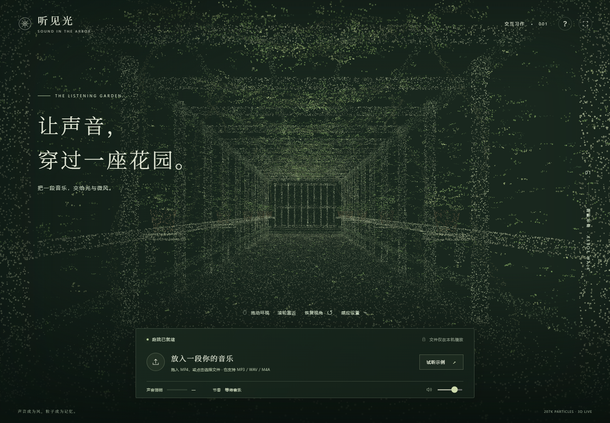

# 听见光 · 粒子庭院

一个浏览器中的音乐响应体验。以藤架长廊为场景，使用有真实三维坐标的柔和点云构成柱子、横梁、地面、花盆、藤蔓与叶片。鼠标可以环视、滚轮可以靠近。选入本地 MP4 或音频后，音乐强弱改变粒子大小，节奏活跃度改变晃动速度。

当前版本用于验证场景风格、空间浏览和声音映射。目标用户暂定为希望在听音乐时观看和探索视觉变化的观众；用户定位与后续表达性互动仍需试用验证。



## 运行

需要 Node.js 22 或更新版本和支持 WebGL、Web Audio 的现代浏览器。不需要 npm 安装，也不需要账户或 API 密钥。

```powershell
git clone https://github.com/Emberanna/pfad-assignment-3.git
cd pfad-assignment-3
npm start
```

打开终端显示的 http://127.0.0.1:4173 。本项目使用相对地址，也可以将 `dist/` 交给任意静态网站服务器。不要直接双击 HTML，以免浏览器限制 ES 模块加载。

## 使用

1. 拖动场景环视，滚轮调整距离。方向键也可环视，R 或“恢复视角”复位。
2. 点击文件区域或拖入 MP4 / MP3 / WAV / M4A。点击播放后才会开始播放与音频分析。
3. 也可以点击“试听示例”，再点击播放，聆听本项目生成的 48 秒原创钢琴音色示例。
4. 空格播放/暂停；进度条跳转；更换音乐可载入另一文件。
5. 感应设置调整声音灵敏度与晃动幅度，幅度设为零可保持静止。音量只改变听到的音量，不影响分析结果。

音乐文件通过浏览器对象 URL 本地读取，不上传、不保存在服务器，刷新页面后需重新选择。

## 实现与边界

- `dist/scene.js`：程序化生成有纵深的粒子长廊，WebGL 着色器负责柔和点渲染、位移和大小变化。没有从一张照片恢复完整三维空间，也未使用训练式 3D Gaussian Splatting。
- `dist/audio-features.js`：实时 RMS 能量估计强弱。`dist/rhythm-worklet.js` 在独立音频线程检测起音，通过最近约五秒起音间隔估计节奏活跃度，避免画面帧率影响起音计时。不支持 AudioWorklet 时回退至主线程频谱起音分析。强弱与节奏分别处理。
- “节奏活跃度”不是准确的谱面 BPM，也不识别旋律、情绪或音乐段落。连奏、复杂复调、打击噪声和骤变可能使估计偏差或延迟；弱音可调高灵敏度。
- `dist/app.js`：播放状态、文件拖放、寻址、音频连接、错误与界面反馈。
- MP4 是容器；浏览器是否能播放取决于音频编码。建议 AAC 音轨的 MP4，或使用 MP3/WAV。无声视频无法驱动画面，界面会提示可能静音或没有音轨。
- 未导入文件时庭院只有轻微环境运动；暂停后粒子会逐步恢复安静。
- 使用用户的系统减少动态偏好，降低晃动幅度。低性能设备可降低窗口尺寸；暂未承诺所有手机上的帧率。

## 验证

```powershell
npm run check
```

自动检查音频映射的分离、快慢起音响应、暂停与重置。浏览器验证和真实用户试用记录见 `PROCESS.md`。自动验证不能替代作业要求的另一人试用。

## 资源与鸣谢

- 视觉参考：[Penderecki’s Garden](https://pendereckisgarden.pl/en/studio_more)，以及用户提供的藤架长廊照片。只参考空间构图与点云风格，未拷贝原站代码、点云或音乐，未将参考照片打包进网站。
- [Three.js 0.170.0](https://github.com/mrdoob/three.js/tree/r170)，MIT 许可证，固定版本随项目提供，见 `THIRD_PARTY_NOTICES.md`。
- 浏览器音频分析参考 [MDN AnalyserNode](https://developer.mozilla.org/en-US/docs/Web/API/AnalyserNode)。
- 示例音频由 `tools/create-demo.mjs` 合成，为本项目原创音符序列，无外部录音。重新生成：`node tools/create-demo.mjs`。
- 字体：使用系统已安装的中文衬线字体和无衬线字体，无需外部字体下载。
- 本版本由用户与 Codex 协作完成；AI 使用说明见 `PROCESS.md`。
